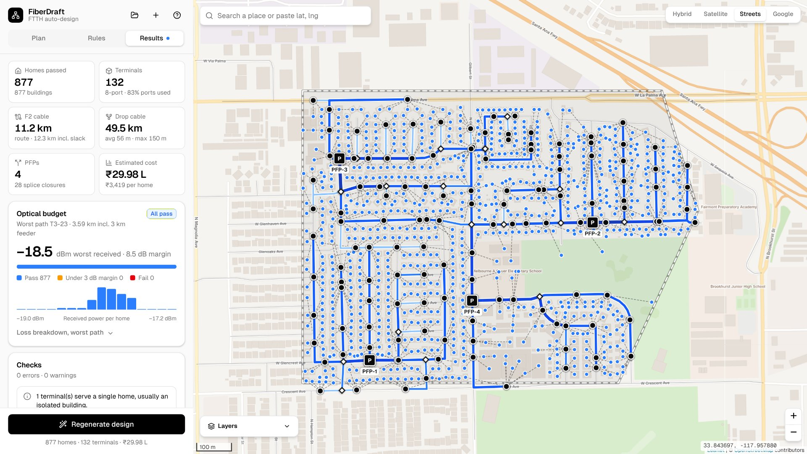

# FiberDraft · FTTH auto-design

FiberDraft drafts an FTTH network in your browser. Search a place, draw the service area, load homes and buildings from OpenStreetMap, then click **Generate**. It places the PFP, routes F2 cables along real streets, and adds splice closures, terminals and drops. Then it checks every drop and the optical budget.



## What it does

- **Service area:** draw it on the map, or import a KML/KMZ from Google Earth.
- **Homes:** loads streets and buildings from OpenStreetMap. It can also estimate homes along streets, or you can add and remove them by hand.
- **Design:** places the PFP (or several PFPs), routes F2 cables, adds splice closures and terminals, and sizes cables with spare fibre.
- **Checks:** drop length limit, optical budget for every home and port use.
- **Results:** bill of materials, terminal schedule and fibre assignment (TIA-598 colours).
- **Export:** KML for Google Earth, GeoJSON for GIS, CSV files, and a printable PDF report.

Everything runs in the browser. There is no server and no sign-up. Projects are saved in your browser's local storage.

## Put it online with GitHub Pages

The app is one file, `index.html`, so it works on GitHub Pages as it is.

1. On GitHub, click **New repository**. Name it `fiberdraft` and set it to **Public**. (A GitHub Free account can publish Pages only from public repositories.)
2. On the new repository page, click **uploading an existing file**. Drag in everything **inside** this folder (`index.html`, `README.md`, `build.py`, `.nojekyll`, `.gitignore`, `src/` and `assets/`), not the folder itself. Click **Commit changes**.
   - Your file browser may hide `.nojekyll` and `.gitignore`. The site works without them.
3. Open **Settings → Pages**. Under **Build and deployment**, set **Source** to **Deploy from a branch**. Choose branch **main** and folder **/ (root)**, then click **Save**.
4. Wait a minute or two. Your site will be live at:

   `https://YOUR-USERNAME.github.io/fiberdraft/`

Each new commit to `main` publishes again on its own.

**Using git instead of the upload page:**

```bash
cd fiberdraft
git init
git add .
git commit -m "FiberDraft"
git branch -M main
git remote add origin https://github.com/YOUR-USERNAME/fiberdraft.git
git push -u origin main
```

Then do step 3 above.

## Google satellite (optional)

The Google basemap uses your own Google Maps Platform key with the **Map Tiles API** turned on. You type the key into the app (**Google** button at the top of the map). The key is saved only in that browser. It is never part of this repository.

- **Never** put the key in any file you commit, and never post it publicly.
- In Google Cloud Console, open **APIs & Services → Credentials** and edit the key:
  - **Application restrictions:** Websites, then add `https://YOUR-USERNAME.github.io/*`
  - **API restrictions:** Map Tiles API only
- Set a budget alert on the billing account.

The Hybrid, Satellite and Streets basemaps need no key.

## Change the code

Edit the files in `src/`, then rebuild `index.html`:

```bash
python3 build.py
```

Commit both the `src/` change and the new `index.html`.

| File | What it holds |
| --- | --- |
| `src/engine.js` | Design engine: street graph, PFP placement, terminal clustering, F2 routing, optical budget, BOM |
| `src/app.js` | Map and user interface |
| `src/kml.js` | KML/KMZ import, and the KML, GeoJSON, CSV and report exports |
| `src/styles.css` | Styles |
| `src/icons.js` | Icons (Lucide) |
| `src/demo.js` | The bundled demo area |
| `src/index.html` | Page template that `build.py` fills in |

## Link previews on LinkedIn (optional)

To show a picture when you share the link, add this line inside `<head>` in `src/index.html`, then run `python3 build.py` and commit:

```html
<meta property="og:image" content="https://YOUR-USERNAME.github.io/fiberdraft/assets/screenshot.jpg">
```

## Data and services

The page loads data from these public services. Please respect their usage policies, and switch to your own or paid providers for heavy or commercial use.

- Streets and buildings: © [OpenStreetMap](https://www.openstreetmap.org/copyright) contributors (ODbL), through public Overpass API servers
- Place search: Nominatim (OpenStreetMap), with Photon as a fallback
- Basemaps: CARTO (Streets), Esri (Satellite and Hybrid) and, with your key, Google Map Tiles API
- Libraries: Leaflet and JSZip from cdnjs, Geist font from Google Fonts

## Notes

- The design is a first draft. A planner should review it before construction.
- Costs use **sample rates** in ₹. Edit them under **Rules → Construction and rates**.
- No license is included yet. If you want others to reuse the code, add one (for example MIT) as a `LICENSE` file.
